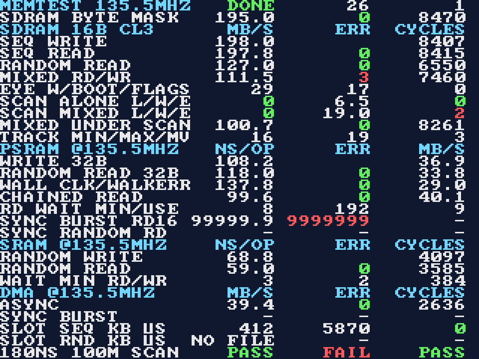

# PSX memory test core (Phase 3)

A small Analogue Pocket core with no PSX logic. It runs the planned memory layout on the real device,
checks every access, and shows measured MB/s, ns per access and error counts on screen.
Roadmap context: [ROADMAP.md](ROADMAP.md) phase 3, [FEASIBILITY.md](FEASIBILITY.md) memory layout.

Source: `pocket/memtest/`. Core id `defgenx.PSXMemTest`, bitstream `memtest.rbf_r`.

## What it tests

One system clock runs every controller and counter. It is 101.6064 MHz (3 × 33.8688 MHz, 9.842 ns) in the default
build and 135.4752 MHz (4 × 33.8688 MHz, 7.381 ns) in the `SDRAM_135` variant, which is the SDRAM clock the PSX core will use;
see [Clock variants](#clock-variants). All times are measured in clock cycles and converted on chip with constants derived from
the clock (`MT_CLK_HZ`, generated into `sdram_timing.vh`); the screen shows MB/s × 10 as
`123.4`. Each test fills or writes a pattern derived from the address (xorshift of address and a
per-run seed), reads it back and counts mismatches, including unknown or floating data. Rows other than SDRAM are
"measured at" the variant's clock: in the 135 variant their screen labels say `@135.5MHZ`.

| Test | What it does | Reported |
|---|---|---|
| SDRAM seq write / seq read | 1 MiB as 131,072 bursts of 4 × 16 bit | MB/s, errors |
| SDRAM random read | 65,536 bursts at random burst addresses in the 1 MiB region (row misses) | MB/s, errors |
| SDRAM mixed | 65,536 random bursts, half reads, half writes; every write carries a random byte-enable mask over its own pattern (so the memory is unchanged) | MB/s, errors |
| SDRAM byte mask | the 1 MiB region at word 0x80000 is filled with the pattern, then rewritten once per burst in a bit-reversed order with the complement pattern under a per-address random byte mask (`be_mask` in `memtest_fn.vh`), then read back in order; every byte must be the new one where the mask is set and the old one where it is clear | write-pass MB/s, readback errors, readback cycles |
| Scan-out alone | One 640 × 16-bit line (160 bursts) per line period of 63.0 µs (6,400 cycles at 101.6 MHz, 8,533.33 at 135.5 MHz), 96 lines | lines late, worst line time (µs), lines |
| Scan-out under mixed traffic | The mixed test above runs while the scan-out stream is active | the same, plus the mixed test's MB/s |
| PSRAM write | 2 × 524,288 single 32-bit writes, both dies: the whole 2 MiB per die | ns per write, MB/s |
| PSRAM random read | 16,384 single 32-bit reads, random die and address over the full 2 MiB per die | busy ns per read, wall-clock ns per read, errors, MB/s |
| PSRAM chained read | 65,536 words as 16-word bursts (CE# held, one address cycle per word) | ns per word, errors, MB/s |
| PSRAM read-wait sweep | random reads with waits covering 49 … 197 ns from address to sample (5 … 20 cycles at 101.6 MHz, 7 … 27 at 135.5) | smallest safe wait (window top + 1 = none: 21 or 28), summed errors, wait used afterwards (smallest + 1) |
| PSRAM address-line walk | per die, word 0 and the words 2^0 … 2^18 are written, then all read back; runs at the wait found by the sweep | errors |
| PSRAM sync burst (optional) | Programs the bus configuration register of both dies, then 16-word synchronous bursts and single-word synchronous reads | ns per word, errors, MB/s |
| SRAM wait sweep | random byte read and write with waits of 9.8 … 78.7 ns (1 … 8 cycles at 101.6 MHz, 2 … 11 at 135.5) | smallest safe wait for read and for write |
| SRAM random byte write / read | 65,536 byte accesses at the safe wait + 1 | ns per access, errors |
| DMA PSRAM → SDRAM | 65,536 words (256 KB) read as 16-word PSRAM bursts, packed into 64-bit SDRAM bursts, then read back and verified | MB/s, errors |

The scan-out stream shares the SDRAM controller through a round-robin arbiter. A line is **late** when
the next line period starts before the line's 160 bursts have returned; this is the "scan-out missed
its deadline" count.

"ns per access" is the time the controller is busy with an access (command accepted to done), so it
excludes the test engine's own hand-off cycles. It is a cycle time, not a first-data latency: a
random PSRAM read at 9 wait cycles is 12 cycles, 118 ns (101.6 MHz). The **wall-clock** figure of the PSRAM random read
is the whole test time divided by the number of reads, so it also counts the 2 hand-off cycles between commands
(wait + 5 cycles per read, 138 ns at wait 9 at 101.6 MHz). "MB/s" for PSRAM uses the busy time (the wall-clock row has its own),
for SDRAM and DMA the wall-clock time of the whole test.

### Gate criteria this core measures

| Row on screen | Criterion (ROADMAP, phase 3) | How it is judged |
|---|---|---|
| `180NS` (first field) | Ganged PSRAM ≤ 180 ns per random 32-bit read | PSRAM random read **wall-clock** ns ≤ 180.0, no errors in the random reads (full 2 MiB per die) and none in the address-line walk |
| `100M` (second field) | DMA path ≥ 100 MB/s | DMA MB/s ≥ 100.0 with no verify errors; the best of async and sync counts |
| `SCAN` (third field) | Scan-out never misses its deadline | no late line alone or under mixed traffic, no data errors anywhere in SDRAM (the byte-mask readback included) |
| SDRAM MB/s rows | SDRAM sustains the Phase 2 worst trace | raw MB/s only; the bandwidth figure is supplied by phase 2 |
| `SLOT SEQ` / `SLOT RND` rows | APF bridge sustains the CD path: 2 × 75 sectors/s × 2,352 bytes | sequential ≥ 352.8 kB/s (decimal) and worst request latency ≤ 6.67 ms (one sector period at 2×) on both rows, no bad requests; read from the screen, not part of the `180NS 100M SCAN` row (pending hardware, see [Bridge throughput bench](#bridge-throughput-bench-slot_benchv)) |

The 180 ns gate judges wall-clock time because the console's ~177 ns is the time between successive
random accesses as the CPU sees it, and a requester pays the hand-off cycles around each command as well; busy time
alone would let a slow part pass. The test engine's 2 hand-off cycles are part of that figure, so it is a conservative
bound for this controller with the simplest requester. At wait *w* a read takes *w* + 5 cycles: at 101.6 MHz
177.2 ns at *w* = 13 passes, 187.0 ns at *w* = 14 fails; at 135.5 MHz 177.2 ns at *w* = 19 passes, 184.5 ns at *w* = 20 fails.
The wait used is the smallest safe wait + 1 (never clamped), so a part whose smallest safe wait is 13 (19 at 135.5 MHz) or more
fails the gate; the sweep reaches 20 (27), so such a part shows its real figure on screen. The threshold is in ns on both clocks.

Each gate shows `---` until its tests have run, `PASS` or `FAIL` after. Nothing on this page is a
hardware result; see [Hardware results](#hardware-results).

## Screen

320 × 240, 40 × 30 characters. Labels are in columns 0–15, three 8-character fields follow.
Numbers are right-aligned, `-` means "not run (yet)", green/red marks error counts and gates.
`DONE` in the state field of row 1 means the sequencer finished.

| Row (from 0) | Label | Field 1 | Field 2 | Field 3 |
|---|---|---|---|---|
| 0 | header `MEMTEST <clock>MHZ` (`101.6` or `135.5`) | `INIT` / `RUN` / `DONE` | last finished step (26 = all) | runs completed |
| 1 | SDRAM BYTE MASK | write-pass MB/s | readback errors | readback cycles |
| 3 | SDRAM SEQ WRITE | MB/s | | cycles |
| 4–6 | SDRAM SEQ READ, RANDOM READ, MIXED RD/WR | MB/s | errors | cycles |
| 7 | EYE W/BOOT/FLAGS | SDRAM read-capture eye width of the last sweep, steps of 153.8 ps | centre chosen by the boot sweep (step) | flags: bit 0 no eye, 1 eye touches 0 or 30, 2 PLL timeout, 3 tracker re-swept ([Calibration contract](#calibration-contract)) |
| 8 | SCAN ALONE L/W/E | late lines | worst line time µs | data errors |
| 9 | SCAN MIXED L/W/E | late lines | worst line time µs | data errors |
| 10 | MIXED UNDER SCAN | MB/s | errors | cycles |
| 11 | TRACK MIN/MAX/MV | lowest capture centre since the boot sweep | highest | centre moves (a re-sweep counts as one) |
| 12, 20, 24 | PSRAM, SRAM, DMA headers | | | in the 135 variant they read `@135.5MHZ` |
| 13 | PSRAM WRITE 32B | ns | | MB/s |
| 14 | PSRAM RANDOM READ 32B | busy ns | errors | MB/s |
| 15 | WALL CLK/WALKERR | wall-clock ns per random read (the 180NS figure) | address-line walk errors | MB/s |
| 16 | CHAINED READ | ns | errors | MB/s |
| 17 | RD WAIT MIN/USE | smallest safe wait (21 = none, 28 at 135.5 MHz) | sweep errors (expected > 0) | wait used |
| 18–19 | SYNC BURST RD16, SYNC RANDOM RD | ns | errors | MB/s |
| 21 | SRAM RANDOM WRITE | ns | | cycles |
| 22 | SRAM RANDOM READ | ns | errors | cycles |
| 23 | WAIT MIN RD/WR | smallest safe read wait | smallest safe write wait | sweep errors (expected > 0) |
| 25–26 | DMA ASYNC, SYNC BURST | MB/s | errors | cycles |
| 27–28 | SLOT SEQ KB US, SLOT RND KB US | kB/s (`NO FILE` if the slot holds no file) | worst request latency µs, issue to last byte | bad requests |
| 29 | 180NS 100M SCAN | gate | gate | gate |



The picture is rendered by the testbench (`sim/tb_screen.v`) from example numbers, not from hardware.

## Settings (APF menu)

| Setting | Default | Effect |
|---|---|---|
| Restart tests | | Resets the controllers and runs everything again with a new seed |
| PSRAM sync burst | Off | After the asynchronous tests, programs both PSRAM dies into synchronous burst mode and runs the sync and DMA-sync tests |
| Sync latency | 3 clocks | Latency counter code written to the device and used to time the reads |
| Sync sample phase | 2 cycles | Cycles after the PSRAM clock edge at which read data is sampled |
| Loop | Run once | Repeat from the start when done (only while the PSRAM is still asynchronous) |

The PSRAM stays in synchronous mode until the core is reloaded. **After a sync run, reload the core
(Core menu) instead of using Restart**; Restart would run the asynchronous tests against a device
that no longer answers them and show errors.

Results can also be read over the APF bridge: word *i* at `0x10000000 + 4·i` is result *i*,
and `0x10000200 + 4·i` is 1 when it is valid. Result numbers are in `fpga/core/memtest_defs.vh`. Results 75 … 89 belong to the
[bridge bench](#bridge-throughput-bench-slot_benchv); a run of the memory tests does not clear them.

## How the controllers work

### SDRAM (`sdram_ctl.v`)

AS4C32M16SB: 16 bit, 4 banks, 8,192 rows × 1,024 columns. Chip select is tied low on the Pocket, so the
idle command is a NOP. Burst length 4, CL 3, open-page policy. Word address mapping: column `[9:0]`,
bank `[11:10]`, row `[24:12]`, so one 1,024-word VRAM line is one row.

Every timing figure lives in one table, `pocket/common/tools/sdram_timing.py`, which generates `pocket/common/mem/sdram_timing.vh`
(cycle counts per clock for `sdram_ctl`, ns figures for `sim/sdram_model.v`), `pocket/common/mem/sdram_timing.sdc` (the
I/O figures `core_constraints.sdc` sources) and `pocket/common/mem/sdram_timing.json` (read by `sim/gpu_diff/bwmodel.py`).
`build.sh compile` and `build.sh sim` fail when a committed generated file differs from the script's output. A
cycle count is `max(minimum clocks, ceil(ns / tCK))`.

#### SDRAM timing table

**Speed grade: unconfirmed.** The part is named only in the SDC comment, "AS4C32M16SB-7"; no Pocket chip marking
or schematic has been checked. The table therefore holds the -7 column, whose CL 3 minimum tCK is 7 ns:
135.4752 MHz (7.38 ns) is 5% inside it, 101.6064 MHz (9.84 ns) 29%. If the part is a -6 the figures only get
better. "B-die" is the AS4C32M16SB datasheet (figures confirmed from its key-specification and AC tables:
tCK3, tAC3, tRAS, tRC); "A-die" is the AS4C32M16SA Rev 2.0 datasheet (-7), used for the figures not read from the
B-die sheet. Where two sources differ the slower figure is kept.

`CLOCKS` in `pocket/common/tools/sdram_timing.py` also generates the clock constants `MT_CLK_HZ` and `MT_TCK_PS` into `sdram_timing.vh`,
under the same `SDRAM_135` selection as the cycle counts. `--check` fails if either `PLL_SYS_MHZ` in `pll_mem.v` differs from
`CLOCKS`, so a clock change is one edit in `CLOCKS` plus the matching PLL values in `pll_mem.v`.

| Figure | ns | Source | Cycles at 101.6 / 135.5 MHz |
|---|---|---|---|
| tCK (CL 3), min | 7.0 | B-die | |
| tAC (CL 3), max | 5.4 | B-die | |
| tOH, min | 2.5 | A-die | |
| tIS / tIH, min | 1.5 / 0.8 | A-die | |
| tRCD, tRP, min | 20 | A-die 15; 20 kept | 3, 3 / 3, 3 |
| tRAS, min | 42 | B-die (A-die 45) | 5 / 6 |
| tRC, min | 63 | B-die (A-die 65) | 7 / 9 |
| tWR, min | 14 and ≥ 2 CLK | A-die tDPL 2 CLK | 2 / 2 |
| tRRD, min | 15 | A-die | 2 / 3 |
| tRFC (= tRC) | 63 | B-die | 7 / 9 |
| tMRD | 2 CLK | A-die | 2 / 2 |
| tREFI | 7,812.5 (8,192 in 64 ms) | A-die | refresh every 6.9 µs: 701 / 934 cycles |
| power-up wait | 200 µs (203 kept) | datasheet | 20,627 / 27,502 cycles |

`sdram_ctl` takes every datasheet cycle count from `sdram_timing.vh` (`SDT_101_*` or `SDT_135_*`), selected once in
`memtest_defs.vh` by the `SDRAM_135` define; the model reads the ns figures from the same file. The controller's own
constants, from its structure rather than the datasheet, are expressed from `CL` and `BL` in `sdram_ctl.v`:

| Constant | Value | Rule |
|---|---|---|
| CAS to CAS | 4 | BL |
| read CAS → write CAS | 9 | CL + BL + 2: the write data never overlaps read data on the bus |
| read CAS → PRECHARGE | 4 | at least BL |
| write CAS → PRECHARGE | 3 + tWR | BL − 1 + tWR (last beat, then tWR) |
| ACT → ACT, same bank | tRC | an explicit per-bank counter, next to tRP (PRECHARGE → ACT) and tRAS (ACT → PRECHARGE) |
| mode register | `0x032` | built from CL (A[6:4]), sequential, BL code (A[2:0]) |

The default 101.6 MHz build takes its cycles from the table too, which changed it from the earlier hand-picked values:
tWR 3 → 2, tRFC 8 → 7, mode register delay 3 → 2, and tRC is now enforced (7; tRAS + tRP = 8 already covered it).
At 135.5 MHz tRAS is 6, tRC 9, tRFC 9, tRRD 3.

**Byte enables.** `sdram_ctl` has a request input `req_be[7:0]`, bit 2k + j enabling byte j of 16-bit word k of the burst (set =
written), driving `dram_dqm` (DQM high = masked) per beat; there is no read-modify-write. DQM has write latency 0: the mask of beat k
is registered on the same edge as the data of beat k, so the first beat's mask leaves with the WRITE command. DQM has read
latency 2, so it is held low for every read and a write's mask cannot reach a read's beats: the next READ is at least
BL cycles after a WRITE and its first beat appears CL cycles after that. The model flags DQM high two edges before any read beat
leaves. `memtest_core` drives all-ones except for the traffic engine's mixed and byte-mask modes. This is the controller a
later unit wires to the PSX VRAM, so the hardware run is also the first look at DQM timing at 135.5 MHz.

**Calibrated capture.** `sdram_ctl` contains `sdram_cal`, which borrows the request port (a registered select in front of the request registers; the
requesters' `req_ready` is low meanwhile) and gates its own read data away from `rd_valid`. `init_done` means "powered up **and** calibrated". The ports
that belong to it, all of which a user of `sdram_ctl` must connect: `pll_locked` (system clock domain), `cal_tick` (one pulse per tracking window),
`clk_scan` / `ps_en` / `ps_up` / `ps_done` (the PLL's `scanclk`, `phase_en`, `updn`, `phase_done`), and the status outputs `cal_done`, `cal_ok`, `cal_width`,
`cal_boot`, `cal_centre`, `cal_min`, `cal_max`, `cal_moves`, `cal_flags`. Contract: [Calibration contract](#calibration-contract).

CL 2 needs a clock of 100 MHz or less on a -7 part (A-die tCK at CL 2: 10 ns), so CL 3 is used. A request is decoded while the previous burst is
still on the bus, so back-to-back reads or writes in an open row issue every 4 cycles (full bus rate,
203 MB/s). Row misses precharge and activate before the burst; the controller does not open the next
request's row early, so the random figures are a floor for what a bank-aware controller could do.

**Pin clock, capture clock and pipeline.** `dram_clk` comes out of a DDIO register driven by a second PLL output,
`clk_sd`, so the clock pin has the same pad delay as the data and command pins. Read data is captured in the I/O cell by a
third PLL output, `clk_cap`, whose phase the calibration sets at run time ([Calibration contract](#calibration-contract)), then moved to the system clock. Command, address and write data pass one fabric register
before the I/O-cell registers of the pins, and the capture register two fabric registers on `clk_cap` (`dq_cap2` next to the I/O cell, `dq_cap3` next to the transfer) before the system clock:
the I/O cells sit several ns of routing away from the core (3.9 ns slow-model from the capture register to a flip-flop
next to it), so neither side may have logic around its I/O register at 135 MHz. A registered read result therefore
appears CL + 6 cycles after the decision (`LAT` in `sdram_ctl.v`). Timing flags (a counter is 0 *now*) are registered one cycle
ahead, no command is decided in the cycle after a command (commands of one request are at least 3 cycles apart), and the open
row of the pending request is compared once, when it is accepted; none of this changes a cycle count.

**Phases, and why.** The clock reaches the pin well after it reaches the core's registers (slow model: clock network 2.6 ns,
DDIO 2.1 ns, output buffer 2.0 ns), and that delay varies between the slow and fast models. The analyser times the command, address
and write-data pins against the generated pin clock with the table's tIS 1.5 / tIH 0.8 ns (`core_constraints.sdc` sources
`sdram_timing.sdc`). With φsd and φc the delays of `clk_sd` and `clk_cap` after `clk_sys` (PLL phase steps of
153.8 ps, 1/8 of the VCO period) and T the period, the slacks of the pins are, to within 0.01 ns of the compiles, and those the read
capture had when it was still timed against tAC 5.4 / tOH 2.5 ns as a 2-cycle path to `clk_cap`:

| | setup (slow models) | hold (fast models) |
|---|---|---|
| read capture (no longer analysed) | (φc − φsd) + 2T − 7.63 − tAC | (φsd − φc) + 2.35 + tOH − T |
| command / write data pins | φsd − 3.3 | T − φsd − 1.38 |

7.63 and 2.35 ns are the slow and fast values of (clock to pin + pad to capture register − `clk_cap` to the capture register) read
from the paths in `output_files/<rev>.sdram_paths.rpt` (`tools/sta_report.tcl`); they include setup, hold and clock uncertainty.
Adding the two read-capture slacks removes the phases: **T − (tAC − tOH) − 5.28 ns**, the data window minus the spread of
the slow and fast models. It is +1.66 ns at 101.6 MHz and −0.80 ns at 135.5 MHz: at 135.5 MHz no phase makes both positive, which is why
the capture phase is calibrated at run time instead ([Calibration contract](#calibration-contract)) and that path is not analysed.
The same formulas place the window: its centre is at φsd − 1.5 T + 8.94 ns after the system clock edge (the two limits averaged),
which is what φsd is chosen for.

| | φsd | window centre, from the formula | φc | command setup / hold |
|---|---|---|---|---|
| 101.6064 MHz | 7,688 ps (50 steps) | 1.9 ns, step 12 | calibrated, steps 0 … 30 | +2.97 / +1.68 ns |
| 135.4752 MHz | 4,459 ps (29 steps) | 2.3 ns, step 15 | calibrated, steps 0 … 30 | +0.91 / +1.73 ns |

Driving the pin straight from the clock net (no DDIO) was tried and is worse: the route from the clock
buffer to the output buffer takes 4.7 ns and the buffer 3.2 ns in the slow model. If the SDRAM commands are unstable on hardware, φsd is the first
thing to move: output 1 of the PLL in `tools/gen_pll.sh`; the window moves with it, one step for one step.

### PSRAM (`psram32.v`)

Two chips, each 2 dies × 64 Mbit, address and data multiplexed: `cram_a[21:16]` plus `cram_dq[15:0]`
carrying `A[15:0]` while ADV# is low. Both chips get the same control signals and each drives 16 of the
32 data bits; the die select (`ce0_n` / `ce1_n`) is address bit 22 of the 32-bit word address.
The asynchronous sequence (ADV# pulse, address hold, OE# or WE# phasing, 70 ns access) follows the
`psram.sv` that Adam Gastineau's Pocket cores use.

| Access | Cycles from command to done | What happens |
|---|---|---|
| Single read | wait + 3 | ADV# 1 cycle, address held 1 more, OE# low after the address is released, data sampled `wait` cycles after the address |
| Chained read | wait + 1 per word after the first | CE# stays low, OE# goes high, the next address is latched with a new ADV# pulse |
| Write | 11 (14 at 135.5 MHz) | WE# low from the start for 78 ns (`WR_END`, ≥ 70 ns from ADV#), data on the bus from the 4th cycle (≥ 20 ns before WE# high), byte enables released one cycle after |

`wait` is 88.5 ns by default (9 cycles at 101.6 MHz, 12 at 135.5; a 70 ns access); the sweep finds the smallest value that
reads correctly and the later tests use that value + 1.

Everything that is a time rather than a protocol step is written in ns and converted with `MT_CYC` (`memtest_defs.vh`), so
both clocks keep the same figure: the write length `WR_END`, the default wait, the sweep window, the SRAM waits. The 1-cycle
ADV# pulse, address hold and 2-cycle data offset are minimums that are longer than tVP / tAVS / tAVH at either clock.
The 16-bit command watchdogs (65,535 cycles, 0.48 ms at 135.5 MHz) and the 10-cycle drain of the SDRAM engines only need to
be longer than any command and the controller's pipeline, which holds at both clocks.

The sweep runs 49 … 197 ns (5 … 20 cycles at 101.6 MHz, 7 … 27 at 135.5; 5-bit wait field) so that a slow part is seen as slow instead of being clamped.
Address bits 16 … 18 of the 2 MiB main RAM are the pins `cram_a[18:16]`; the fill, the random reads and the address-line
walk (word 0, then one set address bit at a time up to bit 18, both dies) drive them, so an open or stuck pin among
`cram_a[18:16]`, or two shorted address lines, shows as errors in the 180NS gate.

**No page mode is used.** With address and data multiplexed, the low address bits share the data pins, so an
in-page read cannot change only `A[3:0]` while data is out; the device's datasheet was not available to check
whether it offers one anyway. The "chained" read is the closest this bus allows (it saves chip-select setup only):
at 70 ns per access, asynchronous PSRAM stays below 57 MB/s for 4-byte words, short of the 100 MB/s gate.

**Synchronous burst mode** is implemented because the DMA gate needs it. The bus configuration register is
written with CRE high through an asynchronous write whose address carries the register value
(`A[19:18] = 10`): fixed latency, latency counter = the menu setting, 16-word bursts, no wrap
(value `5D1B` for latency 3; layout taken from the CellularRAM register description and **not verified against
this device's datasheet**). Reads then run `cram_clk` at half the system clock, 50.8 MHz (67.7 MHz in the 135 variant): address latched at
the first rising edge, first word after `latency` clocks, then one word per clock. `wait` is ignored
(fixed latency). The half-rate clock is used because the device's maximum clock is not known here. **At 67.7 MHz the
menu's default latency of 3 clocks (44 ns) is shorter than a 70 ns access, and the part's maximum clock for that
latency code is not known here; the sync tests of the 135 variant may need *Sync latency* raised to 4 or 5 and are
unverified.** The PSRAM design was not changed for the new clock. Writes stay
asynchronous (the fill happens before the mode change). If the device ignores or rejects the register write, the sync
tests report errors; they cannot hang the core.

### SRAM (`sram_test.v`, controller `pocket/common/mem/sram_ctl.v`)

256 KB as `sram_a[16:0]` × 16 bit, used as bytes through `ub_n` / `lb_n`. A read holds the address for
`wait` cycles; a write sets address and data up one cycle before WE# and holds WE# low for `wait`
cycles. The sweep writes or reads at 9.8 … 78.7 ns (1 … 8 cycles at 101.6 MHz, 2 … 11 at 135.5) against a known-good
access at 78.7 ns (8 cycles, 11) and reports the smallest wait that has no error above it. The write sweep alternates the
data polarity per wait value, starting inverted at the lowest one, so a write that does not happen never matches the data
already in the cell.

### Clocks and pins

`pll_mem.v` makes the system clock, the same clock phase-shifted for the SDRAM pin, the same clock for SDRAM read
capture (its phase moved at run time, see [Calibration contract](#calibration-contract)), 6.3504 MHz (pixel) and its 90° copy, and a
33.8688 MHz scan clock for the phase shift, from the 74.25 MHz reference with one
fractional VCO (812.8512 MHz): the system clock is VCO / 8 = 101.6064 MHz or, in the 135 variant, VCO / 6 = 135.4752 MHz; the pixel
clock is VCO / 128 in both. The PLLs are generated (`tools/gen_pll.sh` → `fpga/core/pll_mem_101.v`, `pll_mem_135.v`). Video is 400 × 264
pixels at 60.1 Hz with 320 × 240 active, one scaler mode, 4:3. One line period is 400 pixel clocks = 62.99 µs: 6,400 system cycles at
101.6 MHz and 25,600 / 3 = 8,533.33 at 135.5 MHz. `sd_scan` counts that period with a fractional accumulator (8,533 cycles, one
more every third line), which is the scan-out deadline. Pin assignments and I/O standards are the template's.
The APF framework files in `pocket/common/apf/` and `core_bridge_cmd.v` are unchanged.

## Calibration contract

The 135 variant cannot close the SDRAM read capture statically (see [Phases, and why](#sdram-sdram_ctlv)): the two capture
slacks add up to T − (tAC − tOH) − 5.28 ns, negative at 135.5 MHz. The 5.28 ns is the spread between the slow and fast timing
models, not jitter; one chip at one temperature shows a window of about 3.5 ns. `sdram_cal.v` (instantiated inside `sdram_ctl`)
therefore puts the capture clock `clk_cap` in the middle of the window the chip actually has: an eye sweep at boot, and a tracking
check in vertical blank. The SDRAM stays at the system clock (4 × 33.8688 MHz at 135.5 MHz), so no clock-domain crossing is added.
Both variants calibrate. The figures below are constants in `mem_defs.vh` (`MT_CAL_*`) and `sdram_timing.py` (`CAL_SWMAX`).

### The PLL

`clk_cap` is output 2 of the PLL and moves in steps of 1/8 of the VCO period, 153.8 ps (48 steps per system period at 135.5 MHz,
64 at 101.6 MHz), through the PLL's dynamic phase shift ports: `phase_en`, `updn` (1 = later), `cntsel` (= 2, counter C2),
`scanclk` and `phase_done`.

- **Fractional mode works with it.** A hand-written `altera_pll` cannot: with `pll_type "General"` Quartus accepts the ports and
  connects nothing (a test compile removed all the logic behind `phase_done`), and with `pll_type "Cyclone V"`, `pll_subtype "DPS"` the
  wrapper needs every hardware counter setting, which only the IP generator fills in. `tools/gen_pll.sh` runs `ip-generate` (Altera PLL,
  Fractional-N, 74.25 MHz in, dynamic phase shift ports on) in the Quartus image and writes `fpga/core/pll_mem_101.v` and `pll_mem_135.v`;
  `pll_mem.v` picks one by `SDRAM_135`. Checked on Quartus 21.1 by compiling a standalone project (generated PLL, a state machine
  stepping output 2 and reading `phase_done`) to the end: one fractional PLL, VCO 812.8512 MHz (M 10 + 15,896,260 / 16,777,216),
  C counters 6, 6, 6, 128, 128, 24, the `dps_extra_kick` handshake machine and five `cntsel` cells in the netlist, `phase_done`
  reaching the logic (the same design with `General` reports its output pin as stuck), and all six counter clocks derived by the
  analyser. Whether the shifts really happen on a Pocket is not verified.
- **`scanclk` is output 5**, 33.8688 MHz (system clock / 4, / 3 at 101.6 MHz), from the same PLL and aligned with the system
  clock; it is under the Cyclone V limit of 100 MHz, and in the analyser's clock group of the system clock, so the transfers
  between the two are timed. The wrapper runs a 64-cycle DPRIO initialisation after reset, so the first step comes 1,024 system
  cycles after the PLL locks.
- **Handshake.** In the system domain `sdram_cal` sets the direction and raises `ps_req`. In the scan domain (two flip-flops) it pulses
  `phase_en` for one `scanclk` cycle with `updn`, waits for `phase_done` to fall (at most 32 cycles) and rise (at most 4,096), and
  acknowledges; the system side then drops the request, waits for the acknowledge to fall and counts the step. A timeout sets
  flag bit 2 and the step is counted as taken. `pos` (the step the PLL is at) is cleared only when the PLL is not locked: a reset
  keeps it, and a reset that arrives during a step waits for the step to finish.

### The transfer to the system clock

Read data crosses twice: the I/O-cell register `dq_cap` and the fabric registers `dq_cap2`, `dq_cap3` are on `clk_cap`, `dq_r` is on `clk_sys`
(`sdram_ctl.v`, `LAT`). **Chosen: the sweep is bounded to the phases where `dq_cap3` → `dq_r` meets timing; no retiming stage.**
For any launch phase φ of `clk_cap` after the system edge with φ + path delay + setup < T, the transfer lands in the next system
cycle, so `LAT` is fixed; the sweep therefore covers steps 0 … `MT_CAL_SWMAX` = 30 (0 … 4.61 ns) and never leaves them. A retiming stage
cannot make the transfer independent of the phase: whatever stage follows, some phases put the system clock edge inside the time
`dq_cap3` changes, and covering them takes a second capture edge (the falling one) with a half-cycle path and a multicycle exception
of its own. The window at 135.5 MHz is 29 steps wide with its centre at step 15 (formula in [Phases, and why](#sdram-sdram_ctlv)), so
[1, 29] sits inside [0, 30] with one step to spare on both sides (a real chip's 3.5 ns window, 23 steps, has more); an eye that touches step 0 or 30 sets flag bit 1 (and is what a window wider than the range, such as the
101.6 MHz one, shows).

The analyser keeps the transfer under STA at the static phase 0 with the whole swing as extra setup uncertainty
(`SDT_CAL_SWING` = 30 steps = 4.62 ns, generated into `sdram_timing.sdc`):

```
set_false_path -from [get_ports {dram_dq[*]}] -to [get_clocks $CLK_CAP]
set_clock_uncertainty -setup -add -from [get_clocks $CLK_CAP] -to [get_clocks $CLK_SYS] $SDT_CAL_SWING
```

The first line is the one exception: the dram_dq pin to `dq_cap` path, whose slack depends on the phase the PLL is at, not the static
one. Command, address and write-data pins, `dq_cap` → `dq_cap2` → `dq_cap3`, `dq_cap3` → `dq_r` and every core path stay analysed in all four models.

### Constants

| Item | Value |
|---|---|
| Pattern | the burst `AAAA 5555 AAAA 5555` (first beat `AAAA`; read back `64'h5555AAAA5555AAAA`): every one of the 16 DQ changes on every beat, across bursts too |
| Reserved row | bank 3, row 8191, word address `0x1FFFC00`; the pattern is in its first 8 bursts (columns 0 … 28), written at boot. No requester may use bank 3 row 8191; `sim/sdram_model.v` models it in storage of its own |
| Reads per step | 32 bursts, cycling over the 8 pattern bursts; any word that differs from the pattern, or is unknown, fails the step |
| Boot sweep | steps 0 … 30 (31 probes, one PLL step between probes); the longest run of passing steps wins (the lowest on a tie); centre = start + (width − 1) / 2, rounded down, kept within 1 … 29; the PLL is then walked to it. No passing step: centre = nominal (15 at 135.5 MHz, 12 at 101.6), flag bit 0 |
| Eye gate | width ≥ `MT_CAL_EYE_MIN` = 10 steps (1.54 ns) |
| Tracking period N | 16 frames. The memtest has no vertical blank: a timer of 16 raster frames (264 lines × 63.0 µs = 16.64 ms; 16 frames = 0.27 s = 36.0 M cycles at 135.5 MHz) opens the window. The PSX core opens it in the vertical blank of every 16th frame |
| k | 4: the tracker reads at centre − 4 and centre + 4 |
| Debounce | the centre moves by one step only after 2 consecutive windows agree; a window where both edges pass resets the count |
| Move rule | low edge fails, high passes: centre + 1; high fails, low passes: centre − 1 |
| Limits (no wrap) | the probes are clamped to [0, 30] and the centre to [1, 29]; no step is ever requested outside 0 … 30. Steps 0 and 30 are the ends of the range, not of a period, so nothing wraps |
| Both edges fail | in 2 consecutive windows: a full re-sweep (flag bit 3); the centre it finds counts as one move |
| Refresh | probe reads are ordinary requests: a refresh due in between is served by the controller. A phase step starts only after the probe's last read has returned, whatever the refresh did meanwhile |
| Open GPU row | the probes use bank 3 only: a different row open in bank 3 is precharged and row 8191 opened, so the first access to bank 3 after a window pays tRP + tRCD; the other banks' rows stay open. The controller keeps its own record of open rows, so nothing else changes |
| Reset | any `rst` of the controller (an APF reset, Restart tests) restarts everything: `init_done` falls, requesters are held off, the pattern is written again, the sweep runs in full, min / max / moves restart at the new boot centre. The PLL position is kept |
| In flight | a phase step is requested only when the controller is quiet: no request pending and no read between its READ command and the registered data; the calibration's own reads have all returned. `sdram_cal` hands the port back after the step |

Requesters see `req_ready` low from the reset until the sweep is done (`init_done` includes it), and during each tracking window.
Cost (simulation): the boot sweep takes about 7,500 cycles after the SDRAM power-up sequence (56 µs at 135.5 MHz, 69 µs at 101.6),
a tracking window about 1,150 cycles (8.5 µs) and 8,700 cycles (64 µs) with a re-sweep. The calibration's read data never reaches a requester.

### On screen and the hardware gate

Row 7 shows the width of the last sweep, the boot centre and the flags, row 11 the lowest and highest centre since the boot sweep and the
number of moves. The same words are bridge results 90 … 95 (`R_CAL`, `R_CAL_T`). Hardware gate (pending a Pocket, see
[Hardware results](#hardware-results)): eye ≥ 10 steps at a cold start and after 30 minutes; the lowest and highest centre within ±3 steps of the boot
centre over an hour; every SDRAM row 0 errors in loop mode for an hour, the byte mask included.

## Bridge throughput bench (`slot_bench.v`)

The CD path of the PSX core will pull 2,352-byte sectors through the APF bridge; nothing in the repository had a measured
sustained bridge rate. `slot_bench` measures it with `target_dataslot_read` on the bridge clock `clk_74a` (74.25 MHz).

**Data slot.** `dist/Cores/defgenx.PSXMemTest/data.json` has one slot, `Bench file` (id 1, extension `bin`, not required, `deferload`, no
fixed filename). Put any file of 8 MB or more (the test has no content check) in `Assets/psxmemtest/common/` on the SD card and pick it in the
core's menu. Without a file the core loads as before and the rows show `NO FILE`.

**Test.** After reset release plus 0.1 s, and again on every *Restart tests*, the bench reads the slot size from the APF data table, then
issues `N_REQ` = 256 requests per mode, one at a time, each `target_dataslot_read` of slot 1, 2,352 bytes, to bridge address
`0x20000000`:

| Mode | Offsets |
|---|---|
| sequential | 0, 2,352, 4,704, … contiguous; wraps to 0 before the end of the file |
| random | sector aligned (multiples of 2,352), uniform in the first 2^k sectors where 2^k ≤ file size / 2,352 (at least half the file; a fixed xorshift sequence) |

The sink counts a bridge write with address top byte `0x20` as 4 bytes only when it is inside the window (`0x20000000` .. +2,351) and at the
next expected address, `0x20000000` + bytes counted so far (the data is dropped; `core_top` decodes only this window and the `0x8xxxxxxx`
settings). Any other write with that top byte (outside the window, a repeated or skipped word) is not counted and makes the request bad. A request is
**bad** when it ends with a nonzero `target_dataslot_err`, with other than 2,352 bytes counted, with such a stray write, or after a 1 s timeout (which also ends the test: state 4). Per request the bench records two times, both from the cycle
`target_dataslot_read` is raised: **last byte** (the cycle the counter reaches 2,352; for a short request its done time) and **done**
(the cycle `target_dataslot_done` is seen). Writes that trail the done flag are counted for 16 cycles.

kB/s = bytes received × 1000 / (Σ request time to done) = bytes × 74,250 / Σ cycles, floor (1 kB = 1,000 bytes); the idle cycles between
requests are not in it. Latency µs = cycles × 4 / 297, floor. The conversion runs on `clk_74a` in a 64 / 32 serial divider.

| Results (`memtest_defs.vh`) | Value 0 | Value 1 | Value 2 |
|---|---|---|---|
| `R_SL_SEQ` 75, `R_SL_RND` 78 (screen rows 27, 28) | kB/s (`FFFFFFFF` = no file) | worst issue-to-last-byte µs | bad requests |
| `R_SL_SEQX` 81, `R_SL_RNDX` 84 (bridge only) | worst issue-to-done µs | requests done | bytes received |
| `R_SL_FILE` 87 (bridge only) | file size in bytes | state: 0 idle, 1 running, 2 done, 3 no file, 4 timeout | expected bytes per mode (N × 2,352) |

The bench writes results one word at a time, held for 9 `clk_74a` cycles with a toggle; `memtest_core` samples the toggle after two flip-flops
and writes the word into `res_ram` in a cycle in which its sequencer does not. All slot results are invalidated (state word 1) at the start of
every run and written together at the end. The `ST_INIT` clear of the memory tests stops below result 75.

**Assumptions about the APF** (nothing here was checked against Analogue's documents or a Pocket; the repository only holds `core_bridge_cmd.v`):

1. The data table readable through `datatable_addr` / `datatable_q` (bridge `0xF8001000`) holds two words per slot in the order of `data.json`,
   the slot size in bytes in the second (word 1 for the only slot) and 0 for a slot without a file. The bench reads word 1.
2. A `target_dataslot_read` delivers `length` bytes as consecutive 32-bit bridge writes from `bridgeaddr`, all before `target_dataslot_done`,
   and accepts an offset and length that are multiples of 4 but not of 512 or of the 2,352-byte sector.
3. `core_bridge_cmd` clears `target_dataslot_done` within a few cycles of the command's rising edge and keeps it set until the next command,
   so the bench raises the command for 4 cycles and ignores `done` for 8.
4. A `deferload` slot is not pushed to the core at load time, and the data table is filled once the user has picked a file.
5. Bridge address `0x20000000` is free for data writes, and a read lands there as consecutive words from `bridgeaddr`: a host that writes elsewhere in the
   window or out of order shows as bad requests (the screen cannot otherwise tell where the data went).

A wrong assumption 1 shows as `NO FILE` with a file present; a wrong 2 or 3 as bad requests or the 1 s timeout (state 4).

The gate and its Hardware results rows are in [Gate criteria](#gate-criteria-this-core-measures) and [Hardware results](#hardware-results). If the
sequential rate or the latency fails, the CD phase reads 2,048-byte user data and synthesises the sector headers.

## Clock variants

| Variant | Revision | Define | System / SDRAM clock | Role |
|---|---|---|---|---|
| default | `ap_core` | none | 101.6064 MHz | the clock of the earlier hardware-less results; kept building and simulating |
| 135 | `ap_core_135` | `SDRAM_135` (`VERILOG_MACRO "SDRAM_135=1"`) | 135.4752 MHz | the SDRAM clock of the PSX core: **the variant whose hardware result matters, and the release** |

`fpga/ap_core_135.qsf` sources `ap_core.qsf` and adds the macro, so the two revisions differ in nothing else. The define selects, in
one place (`memtest_defs.vh`, with the clock constants in the generated `sdram_timing.vh` it includes): the clock constants, the `sdram_ctl` cycle counts (`SDT_135_*` instead of `SDT_101_*`), the
scan-out line period, the screen text (`screen_text_135.vh`) and, in `pll_mem.v`, the PLL (its outputs and the SDRAM pin phase). `clk_vid` is
6.3504 MHz in both. The whole `memtest_core` has one `clk`; the only crossing into it is the result writes of the bridge bench (a toggle plus a held address and value).

## Build

```
pocket/memtest/build.sh              # compile both variants + package the release (135)
pocket/memtest/build.sh compile      # Quartus, default variant (ap_core)
pocket/memtest/build.sh compile135   # Quartus, 135.4752 MHz variant (ap_core_135)
pocket/memtest/build.sh package [101|135]   # package fpga/output_files/<revision>.rbf (default: $RELEASE = 135)
pocket/memtest/build.sh timing [101|135]    # worst slack per clock and model of a finished compile
pocket/memtest/build.sh sim          # simulations only
```

The compile runs Quartus Lite 21.1 in Docker from the repository root (`<rev>` is `ap_core` or `ap_core_135`):

```
docker run --rm --platform linux/amd64 --name memtest_<rev> -v "$PWD":/build -w /build/pocket/memtest/fpga \
    raetro/quartus:21.1 quartus_sh --flow compile ap_core -c <rev>
```

A full compile took 3–8 minutes under x86 emulation on an 11-core Apple-silicon Mac. `build.sh package` then reverses the bits of
`fpga/output_files/<rev>.rbf` into `dist/Cores/defgenx.PSXMemTest/memtest.rbf_r`, checks the JSON files against the
APF limits (`tools/check_json.py`) and zips the SD card layout. It first reads `fpga/output_files/<rev>.sta.summary` and
refuses (exit 1) if the summary is missing or any slack is negative, naming the worst slack and its clock and model;
`ALLOW_TIMING_FAIL=1` packages anyway and prints the worst slack it accepted. The one SDC exception, the pin-to-capture path
([Calibration contract](#calibration-contract)), is what lets the 135 variant pass; nothing else is excluded. `tools/sta_report.tcl` (run with `quartus_sta -t` in `fpga/`)
writes the SDRAM read-capture and command paths of every operating condition to `output_files/<rev>.sdram_paths.rpt`.

Regenerating files that are checked in: `tools/gen_font.py` → `fpga/core/font8x8.hex`,
`tools/gen_screen.py` → `fpga/core/screen_text.vh` (screen labels; the row to result mapping is in `report_fmt.v`),
`tools/gen_pll.sh` → `fpga/core/pll_mem_101.v` and `pll_mem_135.v` (needs Docker and the Quartus image; `build.sh sim` checks their system
clock against the timing table).

## Install

1. Run `build.sh` (or take `dist/` if it already holds `memtest.rbf_r`).
2. Copy the contents of `pocket/memtest/dist/` (`Cores/`, `Platforms/`, `Assets/`) to the root of the Pocket's SD card.
3. Start **PSX Memory Test** from the core list. The tests start on their own; the full run takes well under a second,
   after which the first row shows `DONE`.
4. To try the synchronous PSRAM bursts: set *PSRAM sync burst* to *On*, choose *Restart tests*, read the SYNC and DMA SYNC rows,
   then reload the core.

## Compile results

Quartus Prime Lite 21.1.1, `raetro/quartus:21.1`, `build.sh compile` and `build.sh compile135` (7–13 minutes each under
emulation, two compiles at a time on a loaded machine; `FITTER_EFFORT` is `STANDARD FIT`, because `AUTO FIT` stopped at the fitter's own idea of
"met" and left −0.6 ns after the final analysis). **Both revisions meet timing on every clock in all four models (slow 85 °C / 0 °C,
fast 85 °C / 0 °C), setup and hold, with no critical warning, with the one SDC exception of the
[Calibration contract](#calibration-contract)**: the dram_dq pin to `dq_cap` path is not analysed. Before the calibration the 135 variant
missed that path by 0.42 ns (setup) and 0.38 ns (hold) at the best static phases: the window at 135.5 MHz (T − (tAC − tOH) = 4.48 ns) is narrower than the
spread of the slow and fast models (5.28 ns, including setup, hold and clock uncertainty), and neither a faster `dram_clk` output buffer (12 mA, slew 1: spread 5.21 ns, and an
overshoot risk) nor a delay chain on `dram_dq` (it moves setup against hold) changed that. What the exception hides is on the Pocket
to find out: the calibrated capture has not run on hardware.

| Resource | default (`ap_core`) | 135 (`ap_core_135`) |
|---|---|---|
| ALMs | 5,995 / 18,480 (32%) | 6,261 / 18,480 (34%) |
| Registers | 8,465 | 8,481 |
| Block memory | 45,936 bits in 14 M10K / 308 | 45,936 bits in 14 M10K / 308 |
| DSP | 2 | 2 |
| PLL | 1 fractional, VCO 812.8512 MHz; outputs 101.6064 MHz (0°, 281.3° SDRAM pin, capture clock moved at run time), 6.3504 MHz (0°, 90°), 33.8688 MHz scan clock | the same VCO; 135.4752 MHz (0°, 217.5° SDRAM pin, capture clock moved at run time), 6.3504 MHz (0°, 90°), 33.8688 MHz scan clock |
| I/O | 224 / 224 pins; every SDRAM address, command and data register is packed into its I/O cell | the same |

(Against the last compiles with the slot bench (5,635 and 5,716 ALMs) the calibration, its results writer, the extra `dq_cap3` stage and a
fitter that now works harder add 360 and 545 ALMs. The two DSP blocks were not attributed to a block: the earlier table, from before the slot bench, had none.)

Worst slack per clock, minimum over the four models (the model that produced it in brackets), from
`fpga/output_files/<rev>.sta.summary`. Setup is worst in the slow models, hold in the fast ones, as the analyser does. The system-clock setup
of the 135 variant (+0.053 ns) is a path inside the core, not the calibration's; the next one is +0.163 ns.

| Clock | default: worst setup | default: worst hold | 135: worst setup | 135: worst hold |
|---|---|---|---|---|
| `clk_sys` | +1.750 ns (slow 85 °C) | +0.107 ns (fast 0 °C) | +0.053 ns (slow 0 °C) | +0.091 ns (fast 0 °C) |
| `clk_cap` (`dq_cap` → `dq_cap2` → `dq_cap3`; the pin path is excluded) | +2.948 ns (slow 0 °C) | +0.214 ns (fast 0 °C) | +0.605 ns (slow 0 °C) | +0.230 ns (fast 0 °C) |
| `clk_cap` → `clk_sys` (`dq_cap3` → `dq_r`, 30 steps of swing as uncertainty), in `sdram_paths.rpt` | +1.750 ns (slow 85 °C) | +0.107 ns (fast 0 °C) | +0.163 ns (slow 85 °C) | +0.091 ns (fast 0 °C) |
| `clk_sd` SDRAM clock source | no register paths | | no register paths | |
| `dram_clk_pin` (SDRAM command, address and write data pins) | +2.966 ns (slow 85 °C) | +1.682 ns (fast 0 °C) | +0.908 ns (slow 85 °C) | +1.731 ns (slow 85 °C) |
| `clk_vid` 6.3504 MHz | +149.842 ns (slow 0 °C) | +0.154 ns (fast 0 °C) | +150.040 ns (slow 0 °C) | +0.180 ns (fast 0 °C) |
| `clk_vid_90` | no register paths | | no register paths | |
| `clk_scan` 33.8688 MHz | +4.530 ns (slow 85 °C) | +0.171 ns (fast 0 °C) | +2.819 ns (slow 85 °C) | +0.170 ns (fast 0 °C) |
| `clk_74a` | +3.031 ns (slow 85 °C) | +0.162 ns (fast 0 °C) | +2.712 ns (slow 0 °C) | +0.133 ns (fast 0 °C) |
| `bridge_spiclk` | +10.402 ns (slow 85 °C) | +0.175 ns (fast 0 °C) | +10.797 ns (slow 85 °C) | +0.160 ns (fast 0 °C) |

The crossing's setup slack is what bounds the sweep: at 36 steps the 135 variant failed it by 0.56 ns (the data path is 1.7 ns, the capture clock's tree
is 0.6 ns later than the system clock's), at 32 by 0.15 ns, so the range is 0 … 30. A regional clock for `clk_cap` made it 0.9 ns worse.

Minimum pulse width is positive on every clock (smallest +0.615 ns, on the VCO). PSRAM and SRAM pins are false
paths by design. The audio clock dividers from the APF template have no clock assignment (analyser warning, unchanged from the template).

What was needed to get `clk_sys` to meet 135.4752 MHz (7.38 ns), after the first compile missed by 1.6 ns: the pin and
capture pipeline stages in `sdram_ctl` above, registered timing flags and a registered open-row comparison, the write data
beats 1 to 3 taken from registers that do not depend on the WRITE decision, the PSRAM engine's end-of-test compare and
address check moved off its issue path (`at_end`, `exp_a`, a three-stage read check, one extra cycle at the end of a test or
of a sweep step), a registered SDRAM data check in `sd_traffic` and `sd_scan` (the pipeline must be empty before a test or
a line is complete), a one-hot copy of the sequencer step, the result job table filled one slot per cycle through two shared
register sets, a multi-cycle shift-add scaling of the results by the clock constants, and registered resets. None changes a
cycle count the tests report (the `dq_cap3` stage of the capture path adds one cycle to the read latency, `LAT`; the simulated MB/s are unchanged to the printed digit). How the SDRAM phases are chosen is in [SDRAM](#sdram-sdram_ctlv).

## Verification

Behavioural models in `sim/` (`sdram_model.v`, `psram_model.v`, `sram_model.v`) check the controllers against the
numbers above and flag every violation. The SDRAM model takes every figure from the SDRAM timing table (`sdram_timing.vh`: tAC, tOH,
tRCD, tRP, tRAS, tRC, tRFC, tWR, tRRD, tREFI, and the clock-count minimums) and the test's clock period, and flags tRCD, tRP, tRAS, tRC,
tRRD, tRFC (also before a mode register set and after a refresh), tWR, tMRD, a clock faster than the part's CL 3 minimum,
READ to PRE (≥ BL cycles), PRE during a write burst, DQM high two edges before a read beat leaves, refresh rate (average tREFI
7.8125 µs, at most 8 refreshes postponed), mode register order, bank state, unknown write data, bus overlap, and the model masks write
bytes per DQM bit; PSRAM tVP, tAVS, tAVH, tWP, tDW, tAW, access time, die select,
register write and the synchronous burst; SRAM access time and write pulse width. Unknown data read back counts as an error.

| Simulation (`sim/run.sh <mode>`) | What it covers | Result |
|---|---|---|
| `fast` | whole core, reduced sizes (PSRAM fill 256 words per die; the address-line walk always reaches bit 18), async PSRAM; since the calibration it also needs the eye found (width ≥ 10, boot centre near the nominal one) and no tracker move | PASS |
| `sync` | same plus the synchronous PSRAM tests and DMA | PASS, 177,680 cycles |
| `late` | scan-out line period shortened below what a line needs: late lines must be counted, the gate must fail | PASS: 4 of 4 and 5 of 5 lines late, scan gate FAIL |
| `sd135` | the 135.4752 MHz variant (`-DSDRAM_135`): the full SDRAM and scan-out sizes (1 MiB; 65,536 random bursts, mixed and mixed under scan-out; the 1 MiB byte-mask test; 96 lines), reduced PSRAM / SRAM / DMA sizes; the datasheet model with the read-data pad delay, the capture clock placed by the calibration. PASS needs: every SDRAM row 0 errors, byte-mask readback included, no late line, the scan-out data errors 0, no model violation, every reported MB/s equal to the bench's own count of bytes × clock / cycles, and three consecutive scan-out line periods adding up to exactly 25,600 cycles (3 × 25,600 / 3; literal in the testbench, not from `MT_LINE_*`; `fast` and the other non-`late` runs check 19,200 at 101.6 MHz): an accumulator that never carries gives 25,599 | PASS, 6.49 M cycles (47.9 ms) |
| `slot` | `-DSLOT`: `slot_bench` on a 74.25 MHz clock against a host model in `tb_core.v` that answers `target_dataslot_read` at a fixed rate (16 requests per mode; 550 cycles to the first word, 4,500 for a non-contiguous offset, 30 cycles per 32-bit word, 270 from the last word to done), and the whole `fast` check list of the core. Eight runs: the normal one with a restart in the middle (results invalidated, then reproduced), `-DSLOT_NOFILE` (data table 0: both kB/s fields `FFFFFFFF`, state 3, no request issued), `-DSLOT_SHORT` (every random request one word short: 16 bad requests, last byte = done), `-DSDRAM_135`, `-DSLOT_TRAIL` (the last 3 words of every 4th request written after done, inside the 16-cycle guard: counted, 0 bad sequential; one word 40 cycles after done on the last random request: dropped, 1 bad, 2,348 bytes), `-DSLOT_TMO` (the host delivers all 588 words and never raises done: state 4, 1 sequential request, 1 bad from the timeout alone, 2,352 bytes, no random request), `-DSLOT_ERR` (`target_dataslot_err` = 3 on every 4th request with all data present: 4 bad per mode, full bytes), and `-DSLOT_ADDR` (per 4 requests: clean; a word repeated; a write at `0x20000930` just past the window; one word written 588 times: 12 bad per mode, 28,240 bytes per mode). The model counts a write only at the next expected address, as the bench does. PASS needs the reported kB/s within 0.3% (+2) of the model's, both latencies within 1 µs of the model's own `$realtime` stamps, the request count, bytes received and bad requests, and every request's id, length, window and offset | PASS in all eight: sequential 9,457 kB/s, worst 244 µs to last byte / 248 µs to done, random 7,791 kB/s, 297 / 301 µs, all equal to the model's; short run 7,788 kB/s, 16 bad requests; trail run 1 bad (random), timeout run state 4, error run 4 bad per mode, address run 12 bad per mode with 28,240 bytes; about 6 min for the eight |
| `be`, `be101`, `be135` | `tb_be.v`: `sdram_ctl` against the model with a shadow memory: 40,000 requests, reads and writes mixed, 25,091 writes of which 9,390 with a partial mask and 1,942 with every byte masked (52,866 masked bytes), a hot set of 64 bursts hit again and again and 25% of the requests spread over 512 rows; every read burst is compared with the shadow, and at the end every word of the model's array (40,040 words) is compared byte by byte | PASS at 101.6064 and at 135.4752 MHz, 0 mismatches, 0 model violations |
| `be` with `-DBE_FAULT` | the lane-0 DQM bit inverted between controller and model; the test must report mismatches | PASS = the fault is caught: 14,909 read bursts and 40,038 words wrong |
| `full`, `fullsync` | the sizes the hardware runs (1 MiB SDRAM, 2 MiB per PSRAM die, 65,536 words, …), default variant | both PASS: 24.10 M cycles (237 ms) with sync, 23.37 M (230 ms) without; all errors 0, no model violations; about 12 min of Icarus time each |
| `fast` with `-DPS_STUCK_BIT=18` (or 16) | the PSRAM model forces word address bit 18 (16) to 0 (`-DPS_STUCK_HI`: to 1) | PASS = the fault is caught: walk errors 2, 180NS gate FAIL |
| `fast` with `-DPS_BRIDGE_BIT=16` | the PSRAM model shorts word address bits 16 and 17 (wired-OR); only the walk can see it | PASS = the fault is caught by the walk alone: walk errors 2, random-read errors 0, 180NS gate FAIL |
| `fast` with `-DPS_TAA=<ns>` | PSRAM model access time instead of 70 ns; the sweep must find a larger wait (default variant) | 110: smallest safe wait 12, used 13, wall 177.2 ns, gate PASS (`-DPS_GATE_PASS`); 120: 13 / 14 / 187.0 ns, FAIL; 140: 15 / 16 / 206.7 ns, FAIL; 190: 20 / 21 / 255.9 ns, FAIL |
| `cal` | `tb_cal.v`: `sdram_ctl` with `sdram_cal` against the SDRAM model (its read-data window placed by `PAD_NS` and moved by `drift`) and `pll_dps_model.v`, which moves `clk_cap` one step (0.1538 ns) per `phase_en` pulse and flags a shift outside 0 … 63. In order: *sweep* (width within 1 of the model's window, centre within 1 of its middle, PLL left at the centre); *follow* (traffic with a shadow memory, a tracking window every 3,000 cycles, the window's lower edge drifts from step 1 up to step 18: the centre moves up, stays inside the window, min / max / moves are right, 0 wrong reads in 26,000 requests); *clamp* (window squeezed to steps 0 … 2: centre 1, never below, no shift outside the range); *lost* (no window: re-sweep, flags, centre at the nominal step); *reset* (a reset restarts everything, the eye is found again, statistics restart); and throughout: no phase step with a read in flight, no calibration read reaching a requester, no model violation. Run at both clocks, then at 135.5 MHz with the controller's "quiet" forced to 1, which must be caught as steps taken with reads in flight | PASS at 101.6 and 135.5 MHz (135.5: eye 29 steps, centre 15, boot sweep 7,538 cycles = 56 µs, tracking window 1,152 cycles on average, 8,673 at most); PASS (fault caught): 5 steps with a read in flight |
| `sd135` with `-DCAL_FRAMES=1` | the `sd135` run with a tracking window every raster frame (the default is 16), so the probes run in the middle of every test | PASS, 2 windows, every row 0 errors, no late line, MB/s unchanged |
| `tb_screen.v` | result store → formatter → text RAM → video frame, number formats, a rendered frame (the calibration rows included); run for both screen texts | PASS (default and `-DSDRAM_135`) |
| `tb_div.v` | the divider against `/` on 2,000 random operands and divide by zero | PASS |

The `PS_STUCK_BIT`, `PS_STUCK_HI`, `PS_BRIDGE_BIT`, `PS_TAA` and `PS_GATE_PASS` defines go through `EXTRA`, e.g.
`EXTRA="-DPS_STUCK_BIT=18" sim/run.sh fast`. `build.sh sim` runs `fast`, `sync`, `late`, the `PS_TAA` 110 (with
`PS_GATE_PASS`) and 120 variants, `PS_STUCK_BIT` 16 and 18, `PS_BRIDGE_BIT` 16, `sd135`, `cal` (both clocks and the fault), `sd135` again with `-DCAL_FRAMES=1`, `be` (both clocks and the fault), `slot` (eight whole-core runs), `tb_div` and
`tb_screen` (about 8 min), and exits non-zero unless every one prints `PASS`. `full` and `fullsync` are run by hand: they are the only runs where the
fill and the random reads span 2 MiB, so a regression in that addressing shows only there. A deliberately wrong DQM in the whole core
(`dram_dqm | 2'b10` into the model, run by hand) makes the byte-mask readback report 2,048 errors in the fast sizes and the SCAN gate fail.

`sd135` and the full-size runs print `MIXED MB/s` and `MIXED UNDER SCAN MB/s` for the comparison with the bandwidth model
(`sim/gpu_diff/bwmodel.py`, mixed random bursts):

| Simulated MB/s | 101.6064 MHz (`full`) | 135.4752 MHz (`sd135`) |
|---|---|---|
| MIXED | 89.5 | 119.3 |
| MIXED UNDER SCAN | 75.9 | 105.8 |

Simulated times on this page are what the core prints, truncated to 0.1. The core scales cycles by constants computed from the
clock (`K_MBPS`, `K_NS10`, `K_US10` in `memtest_core.v`, 20 fractional bits), so the figures are exact to the truncation; the wall-clock
figure of the PSRAM random read includes the start-up cycles of the run spread over its reads, so a 13-wait read (18 cycles,
177.17 ns) prints 177.2 and the default random read (14 cycles, 137.80 ns) 137.8 in `fast` and 137.7 in `full`. The 180 ns gate
compares the printed figure.

What the full-size simulation reports (behavioural models at 101.6064 MHz; **not** hardware, shown to make the units
and the expected shape of the results concrete), next to the SDRAM-clock-135 figures from `sd135` (PSRAM, SRAM and DMA rows
there at 135.4752 MHz and reduced sizes; the model's 70 ns access time makes the smallest safe PSRAM wait 10 cycles, used 11):

| Test | Simulated at 101.6064 MHz | Simulated at 135.4752 MHz |
|---|---|---|
| SDRAM seq write / read | 198.4 / 198.7 MB/s (bus limit 203) | 265.5 / 265.7 MB/s (bus limit 271) |
| SDRAM random read, mixed, mixed under scan-out | 93.1, 89.5, 75.9 MB/s | 124.0, 119.3, 105.8 MB/s |
| SDRAM byte-mask write pass (random order, row misses) | 67.2 MB/s | 89.7 MB/s |
| Scan-out line time, alone / under mixed traffic | 6.6 µs / 25.4 µs of 63 µs, no late line | 4.9 µs / 19.3 µs of 63 µs, no late line |
| PSRAM write / random read (busy) / chained read | 108 ns / 118 ns / 99.6 ns per word (36.9 / 33.8 / 40.1 MB/s); random read wall-clock 137.7 ns | 103 ns / 103 ns / 89.4 ns per word; random read wall-clock 118.1 ns |
| PSRAM sync burst (latency 3, 50.8 MHz clock) | 25.8 ns per word, 154.8 MB/s; single-word read 118 ns | not run (67.7 MHz clock, see PSRAM) |
| SRAM random byte write / read | 68.8 / 59.0 ns (model access time 25 ns, smallest safe wait 3 read, 2 write) | 59.0 / 51.6 ns (smallest safe wait 4 read, 3 write) |
| DMA PSRAM → SDRAM, async / sync | 39.6 / 147.7 MB/s | 44.0 MB/s / not run |

The models are mine, written from the same understanding of the datasheets as the controllers, so a shared misreading
would pass both. The SDRAM model's read data is delayed by a pad delay (`PAD_NS`, `sim/cal_sim.vh`: 2.35 ns at 135.5 MHz, 2.82 at 101.6) and the capture
clock comes from the PLL stand-in, so the calibration finds the window by itself; the SDRAM clock phase and the real pad delays remain covered only by the
static timing analysis and, for the capture, by the calibration on the Pocket.

## Hardware results

Every cell needs a Pocket. The first block is the default 101.6 MHz variant, the second the 135 variant (`ap_core_135`), whose
result is the one that matters for the PSX core.

| Measurement | Value | Gate |
|---|---|---|
| SDRAM seq write MB/s | pending — needs a Pocket | |
| SDRAM seq read MB/s | pending — needs a Pocket | |
| SDRAM random read MB/s | pending — needs a Pocket | worst trace ≤ 80% of this (figure from phase 2) |
| SDRAM mixed MB/s | pending — needs a Pocket | |
| Scan-out late lines, alone / under mixed | pending — needs a Pocket | 0 |
| Scan-out worst line time µs | pending — needs a Pocket | < 63 |
| SDRAM errors | pending — needs a Pocket | 0 |
| PSRAM random read ns, busy / wall-clock | pending — needs a Pocket | wall-clock ≤ 180 |
| PSRAM address-line walk errors | pending — needs a Pocket | 0 |
| PSRAM chained read ns per word, MB/s | pending — needs a Pocket | |
| PSRAM smallest safe read wait (cycles) | pending — needs a Pocket | |
| PSRAM write ns | pending — needs a Pocket | |
| PSRAM sync burst ns per word, MB/s (works at all?) | pending — needs a Pocket | |
| SRAM smallest safe wait, read / write (cycles) | pending — needs a Pocket | |
| SRAM random byte read / write ns | pending — needs a Pocket | |
| DMA async MB/s | pending — needs a Pocket | ≥ 100, or a slowdown judged acceptable |
| DMA sync MB/s | pending — needs a Pocket | ≥ 100 |

135 variant (SDRAM and system clock 135.4752 MHz):

| Measurement | Value | Gate |
|---|---|---|
| SDRAM errors on every row: seq read, random read, mixed, mixed under scan-out, scan data, byte-mask readback | pending — needs a Pocket | 0 |
| Scan-out late lines, alone / under mixed, and worst line time | pending — needs a Pocket | 0, < 63 µs |
| SDRAM seq write / seq read / random read / mixed MB/s | pending — needs a Pocket | |
| MIXED UNDER SCAN MB/s against the bandwidth model's mixed-random prediction | pending — needs a Pocket | within about 10% (simulated: 105.8 MB/s, and the model predicts 105.8) |
| SDRAM read-capture eye width (screen row 7), cold start and after 30 minutes | pending — needs a Pocket | ≥ 10 steps (1.54 ns), flags 0 or 2 |
| Capture centre, lowest and highest since the boot sweep (screen row 11), over an hour | pending — needs a Pocket | within ±3 steps of the boot centre |
| Every SDRAM row in loop mode for an hour, byte mask included | pending — needs a Pocket | 0 errors |
| Byte-mask (DQM) readback errors | pending — needs a Pocket | 0 (first look at DQM timing at 135.5 MHz) |
| PSRAM, SRAM and DMA rows, labelled `@135.5MHZ` (180NS and 100M gates, smallest safe waits, sync burst at 67.7 MHz) | pending — needs a Pocket | as in the table above |
| APF bridge, `target_dataslot_read` in 2,352-byte requests: sequential kB/s | pending — needs a Pocket and a file of 8 MB or more in the slot | ≥ 352.8 kB/s (2 × 75 sectors/s × 2,352 bytes) |
| APF bridge: random-offset kB/s | pending — needs a Pocket and a file | none; the figure for seek-heavy access |
| APF bridge: worst request latency, issue to last byte (screen) and issue to done (bridge result 81 / 84), sequential and random | pending — needs a Pocket and a file | ≤ 6,670 µs (one sector period at 2×); otherwise Phase 5 reads 2,048-byte user data and synthesises headers |
| APF bridge: bad requests, `NO FILE` with a file present | pending — needs a Pocket and a file | 0, never `NO FILE` (assumptions 1 to 3 of the bench hold) |

## Not verified

- Everything above on real hardware, in particular SDRAM clock phase and CL 3 at 101.6 and 135.5 MHz, DQM timing at 135.5 MHz,
  PSRAM access time and the sweep window (49 … 197 ns), SRAM speed.
- **The SDRAM read capture of the 135 variant is calibrated, not timed**: the pin-to-capture path is excluded from the analysis (the one SDC exception,
  [Calibration contract](#calibration-contract)) and the PLL's dynamic phase shift has only been through synthesis and fit and the simulation's stand-in.
  Open on a Pocket: that `phase_en` really moves output C2 by one 153.8 ps step per pulse in fractional mode (`cntsel` = 2 is the counter index; the step count
  is what the eye width in steps and the ±3-step gate rest on), how long `phase_done` stays low, the size of the real window, and whether it lies inside
  steps 0 … 30 (30 is where the dq_cap3 → dq_r transfer stops meeting timing).
- The PSRAM synchronous burst at 67.7 MHz (the 135 variant's half clock): the default latency code 3 is shorter than a 70 ns
  access, and the part's maximum clock for each code is unknown.
- The PSRAM bus configuration register layout, the maximum synchronous clock, and whether fixed-latency burst reads work at all.
- The SDRAM speed grade (see the SDRAM timing table): the Pocket's chip marking was not checked, so the -7 column
  is assumed. PSRAM datasheet figures are from memory of the usual part family; its exact part number was not
  looked up.
- The APF side of the bridge bench: the data table layout, the `target_dataslot_read` semantics and the free bridge window, see
  [Bridge throughput bench](#bridge-throughput-bench-slot_benchv) (five assumptions, none checked on a Pocket).
- `cram*_wait` is not used.
- `cram_a[21:19]` are never driven (2 MiB needs only `cram_a[18:16]`), and a swapped pair of address pins is a
  consistent remap that no memory test, and no console, can see.

## Sources and licences

| Source | What was taken | Licence |
|---|---|---|
| Analogue openFPGA core template v1.3.0 (`open-fpga/core-template`, commit `da3a021`) | `pocket/common/apf/*` (via the C64 port, identical except line endings), `core_bridge_cmd.v`, the `core_top.v` port list, bridge and audio blocks, `icon.bin`, JSON layout | No licence file. Each source file carries Analogue's Software License Agreement header (use under the Pocket EULA, `analogue.link/pocket-eula`; the MIT or GPL prevails where it applies) |
| `defgenx/openfpga-C64` | `ap_core.qsf` pin and I/O assignments and fast-register assignments, `build.sh` structure, `tools/check_json.py`, `tools/reverse_bits.py`, `tools/font8x8_basic.h` | No licence file; its README states GPL v2 or later for the Pocket-specific code |
| `defgenx/openfpga-AtariST` | the direct `altera_pll` instantiation style, the DDIO SDRAM clock and the SDC pin timing pattern were read and re-written, not copied | No licence file; same author |
| `defgenx/openfpga-SNES` | read for the SDRAM clock handling; nothing copied | GPL v3 |
| `apf-ref-*` | read only | `apf-ref-amiga`: GPL v3; `apf-ref-utils`: MIT |
| `agg23/analogue-pocket-utils` `psram.sv` (Adam Gastineau) | the asynchronous PSRAM access sequence and timing figures were followed in a new implementation (`psram32.v`) | MIT, © 2022 Adam Gastineau |
| font8x8 (Daniel Hepper) | `tools/font8x8_basic.h`, `fpga/core/font8x8.hex` | public domain |

This directory's own code is part of PSX_MiSTer and follows the repository licence (GPL v2).
